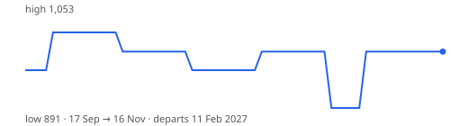
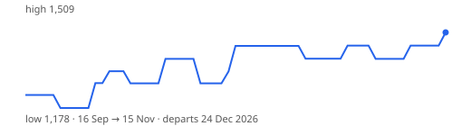

> ⚠️ **SAMPLE DATA.** These prices are synthetic, generated to demo the tracker. They are not real fares.

# Flight price tracker: buy-timing report

Updated 2026-11-15 22:20 UTC.

| Trip | Dates | Days out | Price now | Typical range | Advice | Confidence | Chance cheaper later |
|---|---|---:|---:|---|---|---|---:|
| TLV → Amsterdam (AMS) | Thu 24 Dec → Mon 28 Dec 2026 | 39 | 2,080 ILS | 1,092–1,495 | 🟡 WATCH | Low (57%) | 47% |
| TLV → Amsterdam (AMS) | Thu 11 Feb → Mon 15 Feb 2027 | 88 | 1,188 ILS | 1,092–1,495 | 🟡 WATCH | Low (50%) | 50% |
| TLV → Barcelona (BCN) | Thu 24 Dec → Mon 28 Dec 2026 | 39 | 1,701 ILS | 931–1,274 | 🟢 BUY | Medium (74%) | 16% |
| TLV → Barcelona (BCN) | Thu 11 Feb → Mon 15 Feb 2027 | 88 | 1,012 ILS | 931–1,274 | 🔵 WAIT | Medium (69%) | 69% |
| TLV → Rome (FCO) | Thu 24 Dec → Mon 28 Dec 2026 | 39 | 1,509 ILS | 779–1,066 | 🔵 WAIT | Medium (74%) | 64% |
| TLV → Rome (FCO) | Thu 11 Feb → Mon 15 Feb 2027 | 88 | 862 ILS | 779–1,066 | 🔵 WAIT | High (89%) | 89% |

**BUY** = unlikely to get meaningfully cheaper before the deadline. **WAIT** = good odds of a lower price; keep watching. **WATCH** = roughly a coin flip; buy if it hits the target price.

## TLV → Amsterdam: 24 Dec – 28 Dec 2026 · 🟡 WATCH

Trip: watch +5w · Cheapest airline now: Demo Air · Data points: 61 · Target price: 1,976 ILS · Likely lowest before deadline: ~1,987 ILS

- 47% chance of a fare at least 5% cheaper before 2026-12-10.
- Price is above Google's typical range (1,092-1,495).
- Lower than 10% of the 61 daily prices seen for this trip in the last 90 days.
- Departure falls in a peak period (Christmas / New Year in Europe); these fares usually rise steadily.

## TLV → Amsterdam: 11 Feb – 15 Feb 2027 · 🟡 WATCH

Trip: watch +12w · Cheapest airline now: Demo Air · Data points: 61 · Target price: 1,129 ILS · Likely lowest before deadline: ~1,129 ILS

- 50% chance of a fare at least 5% cheaper before 2027-01-28.
- Lower than 67% of the 61 daily prices seen for this trip in the last 90 days.

## TLV → Barcelona: 24 Dec – 28 Dec 2026 · 🟢 BUY

Trip: watch +5w · Cheapest airline now: Demo Air · Data points: 61 · Likely lowest before deadline: ~1,701 ILS

- 16% chance of a fare at least 5% cheaper before 2026-12-10.
- Price is above Google's typical range (931-1,274).
- Lower than 43% of the 61 daily prices seen for this trip in the last 90 days.
- Today's price is below this trip's recent level by 8%, a dip worth taking.
- Departure falls in a peak period (Christmas / New Year in Europe); these fares usually rise steadily.

## TLV → Barcelona: 11 Feb – 15 Feb 2027 · 🔵 WAIT

Trip: watch +12w · Cheapest airline now: Demo Air · Data points: 61 · Target price: 961 ILS · Likely lowest before deadline: ~913 ILS

- 69% chance of a fare at least 5% cheaper before 2027-01-28.
- Lower than 67% of the 61 daily prices seen for this trip in the last 90 days.

## TLV → Rome: 24 Dec – 28 Dec 2026 · 🔵 WAIT

Trip: watch +5w · Cheapest airline now: Demo Air · Data points: 61 · Target price: 1,434 ILS · Likely lowest before deadline: ~1,412 ILS

- 64% chance of a fare at least 5% cheaper before 2026-12-10.
- Price is above Google's typical range (779-1,066).
- Lower than 2% of the 61 daily prices seen for this trip in the last 90 days.
- Today's price is above this trip's recent level by 4%, likely a temporary spike.
- Departure falls in a peak period (Christmas / New Year in Europe); these fares usually rise steadily.
- Expected cheapest around 2026-11-16; buy right away if it drops to 1,434 or less.

## TLV → Rome: 11 Feb – 15 Feb 2027 · 🔵 WAIT

Trip: watch +12w · Cheapest airline now: Demo Air · Data points: 61 · Target price: 819 ILS · Likely lowest before deadline: ~771 ILS

- 89% chance of a fare at least 5% cheaper before 2027-01-28.
- Lower than 67% of the 61 daily prices seen for this trip in the last 90 days.
- Today's price is above this trip's recent level by 4%, likely a temporary spike.
- Expected cheapest around 2026-12-23; buy right away if it drops to 819 or less.

