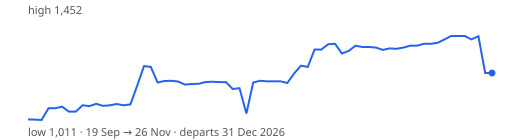
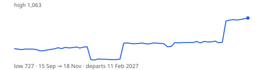
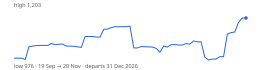

# Flight price tracker: buy-timing report

Updated 2026-11-25 14:17 UTC. 📈 [Price trends over time](TRENDS.md)

| Trip | Dates | Days out | Price now | Typical range | Advice | Confidence | Chance cheaper later |
|---|---|---:|---:|---|---|---|---:|
| TLV → Amsterdam (AMS) | Thu 24 Dec → Mon 28 Dec 2026 | 29 | 1,079 ILS | 1,200–1,900 | 🟢 BUY | Medium (68%) | 48% |
| TLV → Amsterdam (AMS) | Thu 31 Dec → Mon 04 Jan 2027 | 36 | 1,503 ILS | 1,200–1,800 | 🔵 WAIT | Medium (70%) | 70% |
| TLV → Amsterdam (AMS) | Thu 11 Feb → Mon 15 Feb 2027 | 78 | 1,074 ILS | 1,000–1,200 | 🟢 BUY | Medium (67%) | 33% |
| TLV → Amsterdam (AMS) | Thu 18 Feb → Mon 22 Feb 2027 | 85 | 1,099 ILS | 1,050–1,250 | 🟢 BUY | Medium (69%) | 31% |
| TLV → Barcelona (BCN) | Thu 24 Dec → Mon 28 Dec 2026 | 29 | 1,104 ILS | 1,100–1,500 | 🟢 BUY | Medium (64%) | 36% |
| TLV → Barcelona (BCN) | Thu 31 Dec → Mon 04 Jan 2027 | 36 | 1,004 ILS | 1,100–1,550 | 🟢 BUY | High (95%) | 11% |
| TLV → Barcelona (BCN) | Thu 11 Feb → Mon 15 Feb 2027 | 78 | 1,083 ILS | 900–1,100 | 🟡 WATCH | Low (53%) | 47% |
| TLV → Barcelona (BCN) | Thu 18 Feb → Mon 22 Feb 2027 | 85 | – | – | ⚪ NO DATA | – | – |
| TLV → Brussels (BRU) | Thu 24 Dec → Mon 28 Dec 2026 | 29 | 1,101 ILS | 1,200–2,000 | 🔵 WAIT | High (78%) | 93% |
| TLV → Brussels (BRU) | Thu 31 Dec → Mon 04 Jan 2027 | 36 | 1,270 ILS | 1,250–1,950 | 🔵 WAIT | Medium (64%) | 64% |
| TLV → Brussels (BRU) | Thu 11 Feb → Mon 15 Feb 2027 | 78 | 883 ILS | 910–1,100 | 🟢 BUY | High (87%) | 28% |
| TLV → Brussels (BRU) | Thu 18 Feb → Mon 22 Feb 2027 | 85 | 899 ILS | 930–1,150 | 🟢 BUY | High (90%) | 25% |
| TLV → Rome (FCO) | Thu 24 Dec → Mon 28 Dec 2026 | 29 | 440 ILS | 530–1,200 | 🟢 BUY | High (95%) | 4% |
| TLV → Rome (FCO) | Thu 31 Dec → Mon 04 Jan 2027 | 36 | 488 ILS | 540–1,200 | 🔵 WAIT | High (82%) | 97% |
| TLV → Rome (FCO) | Thu 11 Feb → Mon 15 Feb 2027 | 78 | 405 ILS | 370–870 | 🟢 BUY | High (95%) | 0% |
| TLV → Rome (FCO) | Thu 18 Feb → Mon 22 Feb 2027 | 85 | 414 ILS | 380–900 | 🟡 WATCH | Low (51%) | 51% |

**BUY** = unlikely to get meaningfully cheaper before the deadline. **WAIT** = good odds of a lower price; keep watching. **WATCH** = roughly a coin flip; buy if it hits the target price.

## TLV → Amsterdam: 24 Dec – 28 Dec 2026 · 🟢 BUY

Trip: watch +5w · Cheapest airline now: TAROM · Data points: 66 · Likely lowest before deadline: ~1,028 ILS

- 48% chance of a fare at least 5% cheaper before 2026-12-10.
- Price is at or below Google's typical low (1,200).
- Lower than 65% of the 66 daily prices seen for this trip in the last 90 days.
- Departure falls in a peak period (Christmas / New Year in Europe); these fares usually rise steadily.
- Trend over the last 3 weeks: +2.3% per week.

## TLV → Amsterdam: 31 Dec – 04 Jan 2027 · 🔵 WAIT

Trip: watch +5w · Cheapest airline now: KLM · Data points: 68 · Target price: 1,428 ILS · Likely lowest before deadline: ~1,406 ILS

- 70% chance of a fare at least 5% cheaper before 2026-12-17.
- Lower than 1% of the 68 daily prices seen for this trip in the last 90 days.
- Today's price is above this trip's recent level by 3%, likely a temporary spike.
- Departure falls in a peak period (Christmas / New Year in Europe); these fares usually rise steadily.
- Trend over the last 3 weeks: +2.3% per week.
- Expected cheapest around 2026-11-26; buy right away if it drops to 1,428 or less.

## TLV → Amsterdam: 11 Feb – 15 Feb 2027 · 🟢 BUY

Trip: watch +12w · Cheapest airline now: TAROM · Data points: 66 · Likely lowest before deadline: ~1,048 ILS

- 33% chance of a fare at least 5% cheaper before 2027-01-28.
- Lower than 2% of the 66 daily prices seen for this trip in the last 90 days.
- Trend over the last 3 weeks: +13.7% per week.

## TLV → Amsterdam: 18 Feb – 22 Feb 2027 · 🟢 BUY

Trip: watch +12w · Cheapest airline now: TAROM · Data points: 68 · Likely lowest before deadline: ~1,072 ILS

- 31% chance of a fare at least 5% cheaper before 2027-02-04.
- Price is in the cheapest quarter of Google's typical range (1,050-1,250).
- Lower than 1% of the 68 daily prices seen for this trip in the last 90 days.
- Trend over the last 3 weeks: +10.2% per week.

## TLV → Barcelona: 24 Dec – 28 Dec 2026 · 🟢 BUY

Trip: watch +5w · Cheapest airline now: Air Europa · Data points: 66 · Likely lowest before deadline: ~1,064 ILS

- 36% chance of a fare at least 5% cheaper before 2026-12-10.
- Price is in the cheapest quarter of Google's typical range (1,100-1,500).
- Lower than 38% of the 66 daily prices seen for this trip in the last 90 days.
- Departure falls in a peak period (Christmas / New Year in Europe); these fares usually rise steadily.

## TLV → Barcelona: 31 Dec – 04 Jan 2027 · 🟢 BUY

Trip: watch +5w · Cheapest airline now: Air Europa · Data points: 68 · Likely lowest before deadline: ~1,004 ILS

- 11% chance of a fare at least 5% cheaper before 2026-12-17.
- Price is at or below Google's typical low (1,100).
- Lower than 85% of the 68 daily prices seen for this trip in the last 90 days.
- Today's price is below this trip's recent level by 7%, a dip worth taking.
- Departure falls in a peak period (Christmas / New Year in Europe); these fares usually rise steadily.
- Trend over the last 3 weeks: +3.3% per week.

## TLV → Barcelona: 11 Feb – 15 Feb 2027 · 🟡 WATCH

Trip: watch +12w · Cheapest airline now: LOT · Data points: 66 · Target price: 1,029 ILS · Likely lowest before deadline: ~1,031 ILS

- 47% chance of a fare at least 5% cheaper before 2027-01-28.
- Lower than 20% of the 66 daily prices seen for this trip in the last 90 days.
- Expected cheapest around 2026-12-17; buy right away if it drops to 1,029 or less.

## TLV → Barcelona: 18 Feb – 22 Feb 2027 · ⚪ NO DATA

Trip: watch +12w · Data points: 63

- No price found on the last check.

## TLV → Brussels: 24 Dec – 28 Dec 2026 · 🔵 WAIT

Trip: watch +5w · Cheapest airline now: TAROM · Data points: 66 · Target price: 1,046 ILS · Likely lowest before deadline: ~960 ILS

- 93% chance of a fare at least 5% cheaper before 2026-12-10.
- Price is at or below Google's typical low (1,200).
- Lower than 8% of the 66 daily prices seen for this trip in the last 90 days.
- Today's price is above this trip's recent level by 5%, likely a temporary spike.
- Departure falls in a peak period (Christmas / New Year in Europe); these fares usually rise steadily.
- Expected cheapest around 2026-11-26; buy right away if it drops to 1,046 or less.

## TLV → Brussels: 31 Dec – 04 Jan 2027 · 🔵 WAIT

Trip: watch +5w · Cheapest airline now: Brussels Airlines, Lufthansa · Data points: 68 · Target price: 1,206 ILS · Likely lowest before deadline: ~1,179 ILS

- 64% chance of a fare at least 5% cheaper before 2026-12-17.
- Price is in the cheapest quarter of Google's typical range (1,250-1,950).
- Lower than 25% of the 68 daily prices seen for this trip in the last 90 days.
- Departure falls in a peak period (Christmas / New Year in Europe); these fares usually rise steadily.
- Expected cheapest around 2026-11-26; buy right away if it drops to 1,206 or less.

## TLV → Brussels: 11 Feb – 15 Feb 2027 · 🟢 BUY

Trip: watch +12w · Cheapest airline now: SKY express · Data points: 66 · Likely lowest before deadline: ~866 ILS

- 28% chance of a fare at least 5% cheaper before 2027-01-28.
- Price is at or below Google's typical low (910).
- Lower than 2% of the 66 daily prices seen for this trip in the last 90 days.
- Trend over the last 3 weeks: +17.7% per week.

## TLV → Brussels: 18 Feb – 22 Feb 2027 · 🟢 BUY

Trip: watch +12w · Cheapest airline now: TAROM · Data points: 68 · Likely lowest before deadline: ~884 ILS

- 25% chance of a fare at least 5% cheaper before 2027-02-04.
- Price is at or below Google's typical low (930).
- Lower than 6% of the 68 daily prices seen for this trip in the last 90 days.
- Trend over the last 3 weeks: +12.7% per week.

## TLV → Rome: 24 Dec – 28 Dec 2026 · 🟢 BUY

Trip: watch +5w · Cheapest airline now: Wizz Air · Data points: 66 · Likely lowest before deadline: ~436 ILS

- 4% chance of a fare at least 5% cheaper before 2026-12-10.
- Price is at or below Google's typical low (530).
- Lower than 15% of the 66 daily prices seen for this trip in the last 90 days.
- Departure falls in a peak period (Christmas / New Year in Europe); these fares usually rise steadily.

## TLV → Rome: 31 Dec – 04 Jan 2027 · 🔵 WAIT

Trip: watch +5w · Cheapest airline now: Wizz Air · Data points: 68 · Target price: 464 ILS · Likely lowest before deadline: ~440 ILS

- 97% chance of a fare at least 5% cheaper before 2026-12-17.
- Price is at or below Google's typical low (540).
- Lower than 1% of the 68 daily prices seen for this trip in the last 90 days.
- Today's price is above this trip's recent level by 8%, likely a temporary spike.
- Departure falls in a peak period (Christmas / New Year in Europe); these fares usually rise steadily.
- Trend over the last 3 weeks: +3.2% per week.
- Expected cheapest around 2026-11-26; buy right away if it drops to 464 or less.

## TLV → Rome: 11 Feb – 15 Feb 2027 · 🟢 BUY

Trip: watch +12w · Cheapest airline now: Wizz Air · Data points: 66 · Likely lowest before deadline: ~398 ILS

- 0% chance of a fare at least 5% cheaper before 2027-01-28.
- Price is in the cheapest quarter of Google's typical range (370-870).
- Lower than 2% of the 66 daily prices seen for this trip in the last 90 days.

## TLV → Rome: 18 Feb – 22 Feb 2027 · 🟡 WATCH

Trip: watch +12w · Cheapest airline now: Wizz Air · Data points: 68 · Target price: 393 ILS · Likely lowest before deadline: ~393 ILS

- 51% chance of a fare at least 5% cheaper before 2027-02-04.
- Price is in the cheapest quarter of Google's typical range (380-900).
- Lower than 41% of the 68 daily prices seen for this trip in the last 90 days.
- Expected cheapest around 2026-11-26; buy right away if it drops to 393 or less.

_SerpApi searches used this month: 88/248._