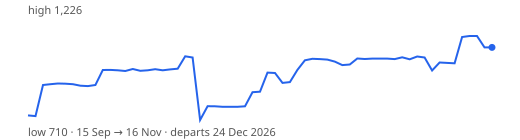

# Flight price tracker: buy-timing report

Updated 2026-11-16 06:40 UTC.

| Trip | Dates | Days out | Price now | Typical range | Advice | Confidence | Chance cheaper later |
|---|---|---:|---:|---|---|---|---:|
| TLV → Amsterdam (AMS) | Thu 24 Dec → Mon 28 Dec 2026 | 38 | 1,152 ILS | 1,150–1,950 | 🟡 WATCH | Low (50%) | 50% |
| TLV → Amsterdam (AMS) | Thu 11 Feb → Mon 15 Feb 2027 | 87 | 1,051 ILS | 1,000–1,200 | 🟢 BUY | Medium (61%) | 39% |
| TLV → Barcelona (BCN) | Thu 24 Dec → Mon 28 Dec 2026 | 38 | 959 ILS | 1,050–1,450 | 🟢 BUY | High (78%) | 37% |
| TLV → Barcelona (BCN) | Thu 11 Feb → Mon 15 Feb 2027 | 87 | 1,064 ILS | 880–1,100 | 🟡 WATCH | Low (52%) | 48% |
| TLV → Brussels (BRU) | Thu 24 Dec → Mon 28 Dec 2026 | 38 | 1,252 ILS | 1,150–2,000 | 🔵 WAIT | Medium (60%) | 60% |
| TLV → Brussels (BRU) | Thu 11 Feb → Mon 15 Feb 2027 | 87 | 869 ILS | 890–1,100 | 🟢 BUY | High (78%) | 37% |
| TLV → Rome (FCO) | Thu 24 Dec → Mon 28 Dec 2026 | 38 | 448 ILS | 540–1,150 | 🟢 BUY | High (96%) | 19% |
| TLV → Rome (FCO) | Thu 11 Feb → Mon 15 Feb 2027 | 87 | 398 ILS | 365–850 | 🟢 BUY | High (100%) | 0% |

**BUY** = unlikely to get meaningfully cheaper before the deadline. **WAIT** = good odds of a lower price; keep watching. **WATCH** = roughly a coin flip; buy if it hits the target price.

## TLV → Amsterdam: 24 Dec – 28 Dec 2026 · 🟡 WATCH

Trip: watch +5w · Cheapest airline now: KLM · Data points: 63 · Target price: 1,094 ILS · Likely lowest before deadline: ~1,094 ILS

- 50% chance of a fare at least 5% cheaper before 2026-12-10.
- Lower than 40% of the 63 daily prices seen for this trip in the last 90 days.
- Departure falls in a peak period (Christmas / New Year in Europe); these fares usually rise steadily.

## TLV → Amsterdam: 11 Feb – 15 Feb 2027 · 🟢 BUY

Trip: watch +12w · Cheapest airline now: TAROM · Data points: 63 · Likely lowest before deadline: ~1,019 ILS

- 39% chance of a fare at least 5% cheaper before 2027-01-28.
- Lower than 3% of the 63 daily prices seen for this trip in the last 90 days.
- Trend over the last 3 weeks: +7.4% per week.

## TLV → Barcelona: 24 Dec – 28 Dec 2026 · 🟢 BUY

Trip: watch +5w · Cheapest airline now: Bluebird Airways · Data points: 63 · Likely lowest before deadline: ~924 ILS

- 37% chance of a fare at least 5% cheaper before 2026-12-10.
- Price is at or below Google's typical low (1,050).
- Lower than 94% of the 63 daily prices seen for this trip in the last 90 days.
- Departure falls in a peak period (Christmas / New Year in Europe); these fares usually rise steadily.
- Trend over the last 3 weeks: -3.6% per week.

## TLV → Barcelona: 11 Feb – 15 Feb 2027 · 🟡 WATCH

Trip: watch +12w · Cheapest airline now: LOT · Data points: 63 · Target price: 1,011 ILS · Likely lowest before deadline: ~1,012 ILS

- 48% chance of a fare at least 5% cheaper before 2027-01-28.
- Lower than 37% of the 63 daily prices seen for this trip in the last 90 days.
- Expected cheapest around 2026-12-24; buy right away if it drops to 1,011 or less.

## TLV → Brussels: 24 Dec – 28 Dec 2026 · 🔵 WAIT

Trip: watch +5w · Cheapest airline now: ITA · Data points: 63 · Target price: 1,189 ILS · Likely lowest before deadline: ~1,172 ILS

- 60% chance of a fare at least 5% cheaper before 2026-12-10.
- Lower than 3% of the 63 daily prices seen for this trip in the last 90 days.
- Departure falls in a peak period (Christmas / New Year in Europe); these fares usually rise steadily.
- Trend over the last 3 weeks: +4.7% per week.
- Expected cheapest around 2026-11-17; buy right away if it drops to 1,189 or less.

## TLV → Brussels: 11 Feb – 15 Feb 2027 · 🟢 BUY

Trip: watch +12w · Cheapest airline now: SKY express · Data points: 63 · Likely lowest before deadline: ~842 ILS

- 37% chance of a fare at least 5% cheaper before 2027-01-28.
- Price is at or below Google's typical low (890).
- Lower than 6% of the 63 daily prices seen for this trip in the last 90 days.
- Trend over the last 3 weeks: +9.5% per week.

## TLV → Rome: 24 Dec – 28 Dec 2026 · 🟢 BUY

Trip: watch +5w · Cheapest airline now: Wizz Air · Data points: 63 · Likely lowest before deadline: ~436 ILS

- 19% chance of a fare at least 5% cheaper before 2026-12-10.
- Price is at or below Google's typical low (540).
- Lower than 6% of the 63 daily prices seen for this trip in the last 90 days.
- Departure falls in a peak period (Christmas / New Year in Europe); these fares usually rise steadily.

## TLV → Rome: 11 Feb – 15 Feb 2027 · 🟢 BUY

Trip: watch +12w · Cheapest airline now: Wizz Air · Data points: 63 · Likely lowest before deadline: ~393 ILS

- 0% chance of a fare at least 5% cheaper before 2027-01-28.
- Lower than 5% of the 63 daily prices seen for this trip in the last 90 days.

_SerpApi searches used this month: 8/248._