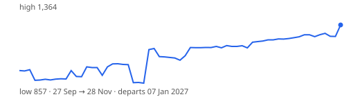
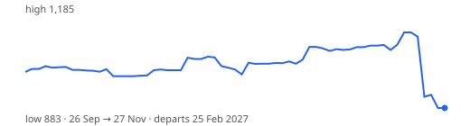
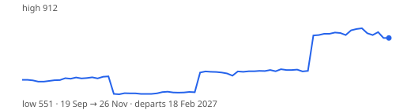
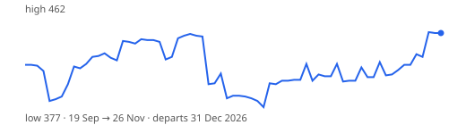

# Flight price tracker: buy-timing report

Updated 2026-11-28 12:57 UTC. 📈 [Price trends over time](TRENDS.md)

| Trip | Dates | Days out | Price now | Typical range | Advice | Confidence | Chance cheaper later |
|---|---|---:|---:|---|---|---|---:|
| TLV → Amsterdam (AMS) | Thu 31 Dec → Mon 04 Jan 2027 | 33 | 1,258 ILS | 1,200–1,800 | 🟢 BUY | High (92%) | 8% |
| TLV → Amsterdam (AMS) | Thu 07 Jan → Mon 11 Jan 2027 | 40 | 1,364 ILS | 1,100–1,550 | 🔵 WAIT | High (95%) | 95% |
| TLV → Amsterdam (AMS) | Thu 18 Feb → Mon 22 Feb 2027 | 82 | 1,017 ILS | 1,050–1,200 | 🟢 BUY | High (89%) | 26% |
| TLV → Amsterdam (AMS) | Thu 25 Feb → Mon 01 Mar 2027 | 89 | 1,084 ILS | 1,050–1,200 | 🟢 BUY | Medium (64%) | 36% |
| TLV → Barcelona (BCN) | Thu 31 Dec → Mon 04 Jan 2027 | 33 | 989 ILS | 1,100–1,500 | 🟢 BUY | Medium (74%) | 41% |
| TLV → Barcelona (BCN) | Thu 07 Jan → Mon 11 Jan 2027 | 40 | 842 ILS | 960–1,150 | 🔵 WAIT | Medium (67%) | 82% |
| TLV → Barcelona (BCN) | Thu 18 Feb → Mon 22 Feb 2027 | 82 | 877 ILS | 910–1,150 | 🔵 WAIT | Medium (71%) | 86% |
| TLV → Barcelona (BCN) | Thu 25 Feb → Mon 01 Mar 2027 | 89 | 918 ILS | 910–1,150 | 🔵 WAIT | High (95%) | 96% |
| TLV → Brussels (BRU) | Thu 31 Dec → Mon 04 Jan 2027 | 33 | 1,259 ILS | 1,200–1,900 | 🟡 WATCH | Low (57%) | 57% |
| TLV → Brussels (BRU) | Thu 07 Jan → Mon 11 Jan 2027 | 40 | 1,027 ILS | 990–1,350 | 🟢 BUY | Medium (68%) | 32% |
| TLV → Brussels (BRU) | Thu 18 Feb → Mon 22 Feb 2027 | 82 | 859 ILS | 920–1,100 | 🟢 BUY | High (91%) | 24% |
| TLV → Brussels (BRU) | Thu 25 Feb → Mon 01 Mar 2027 | 89 | 928 ILS | 920–1,100 | 🟢 BUY | High (75%) | 25% |
| TLV → Rome (FCO) | Thu 31 Dec → Mon 04 Jan 2027 | 33 | 461 ILS | 530–1,150 | 🟢 BUY | High (95%) | 13% |
| TLV → Rome (FCO) | Thu 07 Jan → Mon 11 Jan 2027 | 40 | 423 ILS | 405–670 | 🟢 BUY | High (95%) | 0% |
| TLV → Rome (FCO) | Thu 18 Feb → Mon 22 Feb 2027 | 82 | 424 ILS | 375–880 | 🔵 WAIT | Medium (67%) | 67% |
| TLV → Rome (FCO) | Thu 25 Feb → Mon 01 Mar 2027 | 89 | 423 ILS | 375–880 | 🟢 BUY | High (95%) | 1% |

**BUY** = unlikely to get meaningfully cheaper before the deadline. **WAIT** = good odds of a lower price; keep watching. **WATCH** = roughly a coin flip; buy if it hits the target price.

## TLV → Amsterdam: 31 Dec – 04 Jan 2027 · 🟢 BUY

Trip: watch +5w · Cheapest airline now: KLM · Data points: 69 · Likely lowest before deadline: ~1,258 ILS

- 8% chance of a fare at least 5% cheaper before 2026-12-17.
- Price is in the cheapest quarter of Google's typical range (1,200-1,800).
- Lower than 45% of the 69 daily prices seen for this trip in the last 90 days.
- Today's price is below this trip's recent level by 7%, a dip worth taking.
- Departure falls in a peak period (Christmas / New Year in Europe); these fares usually rise steadily.

## TLV → Amsterdam: 07 Jan – 11 Jan 2027 · 🔵 WAIT

Trip: watch +5w · Cheapest airline now: TAROM · Data points: 63 · Target price: 1,296 ILS · Likely lowest before deadline: ~1,223 ILS

- 95% chance of a fare at least 5% cheaper before 2026-12-24.
- Lower than 2% of the 63 daily prices seen for this trip in the last 90 days.
- Today's price is above this trip's recent level by 6%, likely a temporary spike.
- Trend over the last 3 weeks: +3.6% per week.
- Expected cheapest around 2026-11-29; buy right away if it drops to 1,296 or less.

## TLV → Amsterdam: 18 Feb – 22 Feb 2027 · 🟢 BUY

Trip: watch +12w · Cheapest airline now: SKY express · Data points: 69 · Likely lowest before deadline: ~1,016 ILS

- 26% chance of a fare at least 5% cheaper before 2027-02-04.
- Price is at or below Google's typical low (1,050).
- Lower than 22% of the 69 daily prices seen for this trip in the last 90 days.
- Trend over the last 3 weeks: +8.2% per week.

## TLV → Amsterdam: 25 Feb – 01 Mar 2027 · 🟢 BUY

Trip: watch +12w · Cheapest airline now: TAROM · Data points: 63 · Likely lowest before deadline: ~1,054 ILS

- 36% chance of a fare at least 5% cheaper before 2027-02-11.
- Price is in the cheapest quarter of Google's typical range (1,050-1,200).
- Lower than 6% of the 63 daily prices seen for this trip in the last 90 days.
- Trend over the last 3 weeks: +8.2% per week.

## TLV → Barcelona: 31 Dec – 04 Jan 2027 · 🟢 BUY

Trip: watch +5w · Cheapest airline now: Air Europa · Data points: 69 · Likely lowest before deadline: ~952 ILS

- 41% chance of a fare at least 5% cheaper before 2026-12-17.
- Price is at or below Google's typical low (1,100).
- Lower than 88% of the 69 daily prices seen for this trip in the last 90 days.
- Departure falls in a peak period (Christmas / New Year in Europe); these fares usually rise steadily.
- Trend over the last 3 weeks: +3.0% per week.

## TLV → Barcelona: 07 Jan – 11 Jan 2027 · 🔵 WAIT

Trip: watch +5w · Cheapest airline now: Air Europa · Data points: 63 · Target price: 800 ILS · Likely lowest before deadline: ~756 ILS

- 82% chance of a fare at least 5% cheaper before 2026-12-24.
- Price is at or below Google's typical low (960).
- Lower than 97% of the 63 daily prices seen for this trip in the last 90 days.
- Trend over the last 3 weeks: -6.9% per week.
- Expected cheapest around 2026-12-16; buy right away if it drops to 800 or less.

## TLV → Barcelona: 18 Feb – 22 Feb 2027 · 🔵 WAIT

Trip: watch +12w · Cheapest airline now: Air Europa · Data points: 65 · Target price: 833 ILS · Likely lowest before deadline: ~725 ILS

- 86% chance of a fare at least 5% cheaper before 2027-02-04.
- Price is at or below Google's typical low (910).
- Lower than 91% of the 65 daily prices seen for this trip in the last 90 days.
- Trend over the last 3 weeks: -5.7% per week.
- Expected cheapest around 2027-01-27; buy right away if it drops to 833 or less.

## TLV → Barcelona: 25 Feb – 01 Mar 2027 · 🔵 WAIT

Trip: watch +12w · Cheapest airline now: Air Europa · Data points: 64 · Target price: 872 ILS · Likely lowest before deadline: ~721 ILS

- 96% chance of a fare at least 5% cheaper before 2027-02-11.
- Price is in the cheapest quarter of Google's typical range (910-1,150).
- Lower than 95% of the 64 daily prices seen for this trip in the last 90 days.
- Trend over the last 3 weeks: -6.8% per week.
- Expected cheapest around 2027-02-03; buy right away if it drops to 872 or less.

## TLV → Brussels: 31 Dec – 04 Jan 2027 · 🟡 WATCH

Trip: watch +5w · Cheapest airline now: Brussels Airlines, Lufthansa · Data points: 69 · Target price: 1,196 ILS · Likely lowest before deadline: ~1,183 ILS

- 57% chance of a fare at least 5% cheaper before 2026-12-17.
- Price is in the cheapest quarter of Google's typical range (1,200-1,900).
- Lower than 32% of the 69 daily prices seen for this trip in the last 90 days.
- Departure falls in a peak period (Christmas / New Year in Europe); these fares usually rise steadily.

## TLV → Brussels: 07 Jan – 11 Jan 2027 · 🟢 BUY

Trip: watch +5w · Cheapest airline now: LOT · Data points: 63 · Likely lowest before deadline: ~1,003 ILS

- 32% chance of a fare at least 5% cheaper before 2026-12-24.
- Price is in the cheapest quarter of Google's typical range (990-1,350).
- Lower than 13% of the 63 daily prices seen for this trip in the last 90 days.
- Trend over the last 3 weeks: +10.7% per week.

## TLV → Brussels: 18 Feb – 22 Feb 2027 · 🟢 BUY

Trip: watch +12w · Cheapest airline now: SKY express · Data points: 69 · Likely lowest before deadline: ~853 ILS

- 24% chance of a fare at least 5% cheaper before 2027-02-04.
- Price is at or below Google's typical low (920).
- Lower than 22% of the 69 daily prices seen for this trip in the last 90 days.
- Trend over the last 3 weeks: +10.6% per week.

## TLV → Brussels: 25 Feb – 01 Mar 2027 · 🟢 BUY

Trip: watch +12w · Cheapest airline now: SKY express · Data points: 63 · Likely lowest before deadline: ~914 ILS

- 25% chance of a fare at least 5% cheaper before 2027-02-11.
- Price is in the cheapest quarter of Google's typical range (920-1,100).
- Lower than 22% of the 63 daily prices seen for this trip in the last 90 days.
- Trend over the last 3 weeks: +11.4% per week.

## TLV → Rome: 31 Dec – 04 Jan 2027 · 🟢 BUY

Trip: watch +5w · Cheapest airline now: Wizz Air · Data points: 69 · Likely lowest before deadline: ~454 ILS

- 13% chance of a fare at least 5% cheaper before 2026-12-17.
- Price is at or below Google's typical low (530).
- Lower than 4% of the 69 daily prices seen for this trip in the last 90 days.
- Departure falls in a peak period (Christmas / New Year in Europe); these fares usually rise steadily.
- Trend over the last 3 weeks: +4.0% per week.

## TLV → Rome: 07 Jan – 11 Jan 2027 · 🟢 BUY

Trip: watch +5w · Cheapest airline now: Wizz Air · Data points: 64 · Likely lowest before deadline: ~419 ILS

- 0% chance of a fare at least 5% cheaper before 2026-12-24.
- Price is in the cheapest quarter of Google's typical range (405-670).
- Lower than 2% of the 64 daily prices seen for this trip in the last 90 days.
- Trend over the last 3 weeks: +2.0% per week.

## TLV → Rome: 18 Feb – 22 Feb 2027 · 🔵 WAIT

Trip: watch +12w · Cheapest airline now: Wizz Air · Data points: 69 · Target price: 403 ILS · Likely lowest before deadline: ~398 ILS

- 67% chance of a fare at least 5% cheaper before 2027-02-04.
- Price is in the cheapest quarter of Google's typical range (375-880).
- Lower than 14% of the 69 daily prices seen for this trip in the last 90 days.
- Trend over the last 3 weeks: +2.1% per week.
- Expected cheapest around 2026-11-29; buy right away if it drops to 403 or less.

## TLV → Rome: 25 Feb – 01 Mar 2027 · 🟢 BUY

Trip: watch +12w · Cheapest airline now: Wizz Air · Data points: 63 · Likely lowest before deadline: ~420 ILS

- 1% chance of a fare at least 5% cheaper before 2027-02-11.
- Price is in the cheapest quarter of Google's typical range (375-880).
- Lower than 6% of the 63 daily prices seen for this trip in the last 90 days.
- Trend over the last 3 weeks: +3.1% per week.

_SerpApi searches used this month: 112/248._