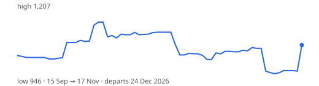

# Flight price tracker: buy-timing report

Updated 2026-11-18 13:00 UTC. 📈 [Price trends over time](TRENDS.md)

| Trip | Dates | Days out | Price now | Typical range | Advice | Confidence | Chance cheaper later |
|---|---|---:|---:|---|---|---|---:|
| TLV → Amsterdam (AMS) | Thu 24 Dec → Mon 28 Dec 2026 | 36 | 1,069 ILS | 1,200–1,900 | 🟢 BUY | High (76%) | 39% |
| TLV → Amsterdam (AMS) | Thu 11 Feb → Mon 15 Feb 2027 | 85 | 1,063 ILS | 1,000–1,200 | 🟢 BUY | Medium (61%) | 39% |
| TLV → Barcelona (BCN) | Thu 24 Dec → Mon 28 Dec 2026 | 36 | 1,096 ILS | 1,050–1,500 | 🔵 WAIT | High (93%) | 93% |
| TLV → Barcelona (BCN) | Thu 11 Feb → Mon 15 Feb 2027 | 85 | 1,139 ILS | 890–1,100 | 🔵 WAIT | High (88%) | 78% |
| TLV → Brussels (BRU) | Thu 24 Dec → Mon 28 Dec 2026 | 36 | 1,091 ILS | 1,200–2,000 | 🔵 WAIT | Medium (67%) | 82% |
| TLV → Brussels (BRU) | Thu 11 Feb → Mon 15 Feb 2027 | 85 | 877 ILS | 900–1,100 | 🟢 BUY | High (78%) | 37% |
| TLV → Rome (FCO) | Thu 24 Dec → Mon 28 Dec 2026 | 36 | 437 ILS | 530–1,150 | 🟢 BUY | High (95%) | 14% |
| TLV → Rome (FCO) | Thu 11 Feb → Mon 15 Feb 2027 | 85 | 401 ILS | 370–870 | 🟢 BUY | High (95%) | 0% |

**BUY** = unlikely to get meaningfully cheaper before the deadline. **WAIT** = good odds of a lower price; keep watching. **WATCH** = roughly a coin flip; buy if it hits the target price.

## TLV → Amsterdam: 24 Dec – 28 Dec 2026 · 🟢 BUY

Trip: watch +5w · Cheapest airline now: TAROM · Data points: 65 · Likely lowest before deadline: ~1,036 ILS

- 39% chance of a fare at least 5% cheaper before 2026-12-10.
- Price is at or below Google's typical low (1,200).
- Lower than 69% of the 65 daily prices seen for this trip in the last 90 days.
- Departure falls in a peak period (Christmas / New Year in Europe); these fares usually rise steadily.

## TLV → Amsterdam: 11 Feb – 15 Feb 2027 · 🟢 BUY

Trip: watch +12w · Cheapest airline now: TAROM · Data points: 65 · Likely lowest before deadline: ~1,028 ILS

- 39% chance of a fare at least 5% cheaper before 2027-01-28.
- Lower than 2% of the 65 daily prices seen for this trip in the last 90 days.
- Trend over the last 3 weeks: +8.7% per week.

## TLV → Barcelona: 24 Dec – 28 Dec 2026 · 🔵 WAIT

Trip: watch +5w · Cheapest airline now: Air Europa · Data points: 65 · Target price: 1,041 ILS · Likely lowest before deadline: ~991 ILS

- 93% chance of a fare at least 5% cheaper before 2026-12-10.
- Price is in the cheapest quarter of Google's typical range (1,050-1,500).
- Lower than 38% of the 65 daily prices seen for this trip in the last 90 days.
- Today's price is above this trip's recent level by 7%, likely a temporary spike.
- Departure falls in a peak period (Christmas / New Year in Europe); these fares usually rise steadily.
- Trend over the last 3 weeks: -2.2% per week.
- Expected cheapest around 2026-11-19; buy right away if it drops to 1,041 or less.

## TLV → Barcelona: 11 Feb – 15 Feb 2027 · 🔵 WAIT

Trip: watch +12w · Cheapest airline now: ITA · Data points: 65 · Target price: 1,082 ILS · Likely lowest before deadline: ~1,060 ILS

- 78% chance of a fare at least 5% cheaper before 2027-01-28.
- Price is above Google's typical range (890-1,100).
- Lower than 2% of the 65 daily prices seen for this trip in the last 90 days.
- Today's price is above this trip's recent level by 4%, likely a temporary spike.
- Expected cheapest around 2026-11-19; buy right away if it drops to 1,082 or less.

## TLV → Brussels: 24 Dec – 28 Dec 2026 · 🔵 WAIT

Trip: watch +5w · Cheapest airline now: TAROM · Data points: 65 · Target price: 1,036 ILS · Likely lowest before deadline: ~975 ILS

- 82% chance of a fare at least 5% cheaper before 2026-12-10.
- Price is at or below Google's typical low (1,200).
- Lower than 14% of the 65 daily prices seen for this trip in the last 90 days.
- Departure falls in a peak period (Christmas / New Year in Europe); these fares usually rise steadily.
- Expected cheapest around 2026-11-19; buy right away if it drops to 1,036 or less.

## TLV → Brussels: 11 Feb – 15 Feb 2027 · 🟢 BUY

Trip: watch +12w · Cheapest airline now: SKY express · Data points: 65 · Likely lowest before deadline: ~849 ILS

- 37% chance of a fare at least 5% cheaper before 2027-01-28.
- Price is at or below Google's typical low (900).
- Lower than 2% of the 65 daily prices seen for this trip in the last 90 days.
- Trend over the last 3 weeks: +11.3% per week.

## TLV → Rome: 24 Dec – 28 Dec 2026 · 🟢 BUY

Trip: watch +5w · Cheapest airline now: Wizz Air · Data points: 65 · Likely lowest before deadline: ~428 ILS

- 14% chance of a fare at least 5% cheaper before 2026-12-10.
- Price is at or below Google's typical low (530).
- Lower than 18% of the 65 daily prices seen for this trip in the last 90 days.
- Departure falls in a peak period (Christmas / New Year in Europe); these fares usually rise steadily.

## TLV → Rome: 11 Feb – 15 Feb 2027 · 🟢 BUY

Trip: watch +12w · Cheapest airline now: Wizz Air · Data points: 65 · Likely lowest before deadline: ~395 ILS

- 0% chance of a fare at least 5% cheaper before 2027-01-28.
- Price is in the cheapest quarter of Google's typical range (370-870).
- Lower than 2% of the 65 daily prices seen for this trip in the last 90 days.

_SerpApi searches used this month: 32/248._