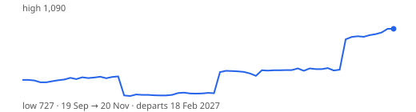
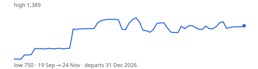

# Flight price tracker: buy-timing report

Updated 2026-11-22 12:33 UTC. 📈 [Price trends over time](TRENDS.md)

| Trip | Dates | Days out | Price now | Typical range | Advice | Confidence | Chance cheaper later |
|---|---|---:|---:|---|---|---|---:|
| TLV → Amsterdam (AMS) | Thu 24 Dec → Mon 28 Dec 2026 | 32 | 1,079 ILS | 1,200–1,900 | 🟢 BUY | Medium (60%) | 55% |
| TLV → Amsterdam (AMS) | Thu 31 Dec → Mon 04 Jan 2027 | 39 | 1,452 ILS | 1,200–1,800 | 🟢 BUY | Medium (66%) | 34% |
| TLV → Amsterdam (AMS) | Thu 11 Feb → Mon 15 Feb 2027 | 81 | 1,074 ILS | 1,000–1,200 | 🟢 BUY | Medium (66%) | 34% |
| TLV → Amsterdam (AMS) | Thu 18 Feb → Mon 22 Feb 2027 | 88 | 1,090 ILS | 1,050–1,200 | 🟢 BUY | High (76%) | 24% |
| TLV → Barcelona (BCN) | Thu 24 Dec → Mon 28 Dec 2026 | 32 | 1,104 ILS | 1,100–1,500 | 🟢 BUY | Medium (71%) | 29% |
| TLV → Barcelona (BCN) | Thu 31 Dec → Mon 04 Jan 2027 | 39 | 1,202 ILS | 1,100–1,500 | 🟢 BUY | High (84%) | 16% |
| TLV → Barcelona (BCN) | Thu 11 Feb → Mon 15 Feb 2027 | 81 | 1,083 ILS | 900–1,100 | 🟡 WATCH | Low (57%) | 43% |
| TLV → Barcelona (BCN) | Thu 18 Feb → Mon 22 Feb 2027 | 88 | 1,036 ILS | – | 🔵 WAIT | Medium (61%) | 79% |
| TLV → Brussels (BRU) | Thu 24 Dec → Mon 28 Dec 2026 | 32 | 1,101 ILS | 1,200–2,000 | 🔵 WAIT | High (78%) | 93% |
| TLV → Brussels (BRU) | Thu 31 Dec → Mon 04 Jan 2027 | 39 | 1,249 ILS | 1,200–2,000 | 🔵 WAIT | Medium (63%) | 63% |
| TLV → Brussels (BRU) | Thu 11 Feb → Mon 15 Feb 2027 | 81 | 883 ILS | 910–1,100 | 🟢 BUY | High (86%) | 29% |
| TLV → Brussels (BRU) | Thu 18 Feb → Mon 22 Feb 2027 | 88 | 913 ILS | 920–1,100 | 🟢 BUY | High (95%) | 15% |
| TLV → Rome (FCO) | Thu 24 Dec → Mon 28 Dec 2026 | 32 | 440 ILS | 530–1,200 | 🟢 BUY | High (95%) | 12% |
| TLV → Rome (FCO) | Thu 31 Dec → Mon 04 Jan 2027 | 39 | 440 ILS | 540–1,200 | 🟡 WATCH | Low (52%) | 63% |
| TLV → Rome (FCO) | Thu 11 Feb → Mon 15 Feb 2027 | 81 | 405 ILS | 370–870 | 🟢 BUY | High (95%) | 0% |
| TLV → Rome (FCO) | Thu 18 Feb → Mon 22 Feb 2027 | 88 | 411 ILS | 375–890 | 🟢 BUY | Medium (60%) | 40% |

**BUY** = unlikely to get meaningfully cheaper before the deadline. **WAIT** = good odds of a lower price; keep watching. **WATCH** = roughly a coin flip; buy if it hits the target price.

## TLV → Amsterdam: 24 Dec – 28 Dec 2026 · 🟢 BUY

Trip: watch +5w · Cheapest airline now: TAROM · Data points: 66 · Likely lowest before deadline: ~1,017 ILS

- 55% chance of a fare at least 5% cheaper before 2026-12-10.
- Price is at or below Google's typical low (1,200).
- Lower than 65% of the 66 daily prices seen for this trip in the last 90 days.
- Departure falls in a peak period (Christmas / New Year in Europe); these fares usually rise steadily.

## TLV → Amsterdam: 31 Dec – 04 Jan 2027 · 🟢 BUY

Trip: watch +5w · Cheapest airline now: KLM · Data points: 65 · Likely lowest before deadline: ~1,398 ILS

- 34% chance of a fare at least 5% cheaper before 2026-12-17.
- Lower than 5% of the 65 daily prices seen for this trip in the last 90 days.
- Departure falls in a peak period (Christmas / New Year in Europe); these fares usually rise steadily.

## TLV → Amsterdam: 11 Feb – 15 Feb 2027 · 🟢 BUY

Trip: watch +12w · Cheapest airline now: TAROM · Data points: 66 · Likely lowest before deadline: ~1,047 ILS

- 34% chance of a fare at least 5% cheaper before 2027-01-28.
- Lower than 2% of the 66 daily prices seen for this trip in the last 90 days.
- Trend over the last 3 weeks: +11.2% per week.

## TLV → Amsterdam: 18 Feb – 22 Feb 2027 · 🟢 BUY

Trip: watch +12w · Cheapest airline now: TAROM · Data points: 65 · Likely lowest before deadline: ~1,078 ILS

- 24% chance of a fare at least 5% cheaper before 2027-02-04.
- Lower than 3% of the 65 daily prices seen for this trip in the last 90 days.
- Trend over the last 3 weeks: +10.7% per week.

## TLV → Barcelona: 24 Dec – 28 Dec 2026 · 🟢 BUY

Trip: watch +5w · Cheapest airline now: Air Europa · Data points: 66 · Likely lowest before deadline: ~1,071 ILS

- 29% chance of a fare at least 5% cheaper before 2026-12-10.
- Price is in the cheapest quarter of Google's typical range (1,100-1,500).
- Lower than 38% of the 66 daily prices seen for this trip in the last 90 days.
- Departure falls in a peak period (Christmas / New Year in Europe); these fares usually rise steadily.

## TLV → Barcelona: 31 Dec – 04 Jan 2027 · 🟢 BUY

Trip: watch +5w · Cheapest airline now: Air Europa · Data points: 65 · Likely lowest before deadline: ~1,190 ILS

- 16% chance of a fare at least 5% cheaper before 2026-12-17.
- Lower than 5% of the 65 daily prices seen for this trip in the last 90 days.
- Departure falls in a peak period (Christmas / New Year in Europe); these fares usually rise steadily.
- Trend over the last 3 weeks: +4.6% per week.

## TLV → Barcelona: 11 Feb – 15 Feb 2027 · 🟡 WATCH

Trip: watch +12w · Cheapest airline now: LOT · Data points: 66 · Target price: 1,029 ILS · Likely lowest before deadline: ~1,036 ILS

- 43% chance of a fare at least 5% cheaper before 2027-01-28.
- Lower than 20% of the 66 daily prices seen for this trip in the last 90 days.
- Expected cheapest around 2026-12-10; buy right away if it drops to 1,029 or less.

## TLV → Barcelona: 18 Feb – 22 Feb 2027 · 🔵 WAIT

Trip: watch +12w · Cheapest airline now: SKY express · Data points: 3 · Target price: 984 ILS · Likely lowest before deadline: ~958 ILS

- 79% chance of a fare at least 5% cheaper before 2027-02-04.
- Expected cheapest around 2026-12-17; buy right away if it drops to 984 or less.

## TLV → Brussels: 24 Dec – 28 Dec 2026 · 🔵 WAIT

Trip: watch +5w · Cheapest airline now: TAROM · Data points: 66 · Target price: 1,046 ILS · Likely lowest before deadline: ~955 ILS

- 93% chance of a fare at least 5% cheaper before 2026-12-10.
- Price is at or below Google's typical low (1,200).
- Lower than 8% of the 66 daily prices seen for this trip in the last 90 days.
- Today's price is above this trip's recent level by 5%, likely a temporary spike.
- Departure falls in a peak period (Christmas / New Year in Europe); these fares usually rise steadily.
- Expected cheapest around 2026-11-23; buy right away if it drops to 1,046 or less.

## TLV → Brussels: 31 Dec – 04 Jan 2027 · 🔵 WAIT

Trip: watch +5w · Cheapest airline now: Brussels Airlines, Lufthansa · Data points: 65 · Target price: 1,187 ILS · Likely lowest before deadline: ~1,160 ILS

- 63% chance of a fare at least 5% cheaper before 2026-12-17.
- Price is in the cheapest quarter of Google's typical range (1,200-2,000).
- Lower than 35% of the 65 daily prices seen for this trip in the last 90 days.
- Departure falls in a peak period (Christmas / New Year in Europe); these fares usually rise steadily.

## TLV → Brussels: 11 Feb – 15 Feb 2027 · 🟢 BUY

Trip: watch +12w · Cheapest airline now: SKY express · Data points: 66 · Likely lowest before deadline: ~866 ILS

- 29% chance of a fare at least 5% cheaper before 2027-01-28.
- Price is at or below Google's typical low (910).
- Lower than 2% of the 66 daily prices seen for this trip in the last 90 days.
- Trend over the last 3 weeks: +14.5% per week.

## TLV → Brussels: 18 Feb – 22 Feb 2027 · 🟢 BUY

Trip: watch +12w · Cheapest airline now: SKY express · Data points: 65 · Likely lowest before deadline: ~911 ILS

- 15% chance of a fare at least 5% cheaper before 2027-02-04.
- Price is at or below Google's typical low (920).
- Lower than 3% of the 65 daily prices seen for this trip in the last 90 days.
- Trend over the last 3 weeks: +14.2% per week.

## TLV → Rome: 24 Dec – 28 Dec 2026 · 🟢 BUY

Trip: watch +5w · Cheapest airline now: Wizz Air · Data points: 66 · Likely lowest before deadline: ~432 ILS

- 12% chance of a fare at least 5% cheaper before 2026-12-10.
- Price is at or below Google's typical low (530).
- Lower than 15% of the 66 daily prices seen for this trip in the last 90 days.
- Departure falls in a peak period (Christmas / New Year in Europe); these fares usually rise steadily.

## TLV → Rome: 31 Dec – 04 Jan 2027 · 🟡 WATCH

Trip: watch +5w · Cheapest airline now: Wizz Air · Data points: 65 · Target price: 418 ILS · Likely lowest before deadline: ~413 ILS

- 63% chance of a fare at least 5% cheaper before 2026-12-17.
- Price is at or below Google's typical low (540).
- Lower than 20% of the 65 daily prices seen for this trip in the last 90 days.
- Today's price is above this trip's recent level by 3%, likely a temporary spike.
- Departure falls in a peak period (Christmas / New Year in Europe); these fares usually rise steadily.
- Expected cheapest around 2026-11-23; buy right away if it drops to 418 or less.

## TLV → Rome: 11 Feb – 15 Feb 2027 · 🟢 BUY

Trip: watch +12w · Cheapest airline now: Wizz Air · Data points: 66 · Likely lowest before deadline: ~398 ILS

- 0% chance of a fare at least 5% cheaper before 2027-01-28.
- Price is in the cheapest quarter of Google's typical range (370-870).
- Lower than 2% of the 66 daily prices seen for this trip in the last 90 days.

## TLV → Rome: 18 Feb – 22 Feb 2027 · 🟢 BUY

Trip: watch +12w · Cheapest airline now: Wizz Air · Data points: 65 · Likely lowest before deadline: ~394 ILS

- 40% chance of a fare at least 5% cheaper before 2027-02-04.
- Price is in the cheapest quarter of Google's typical range (375-890).
- Lower than 45% of the 65 daily prices seen for this trip in the last 90 days.

_SerpApi searches used this month: 64/248._