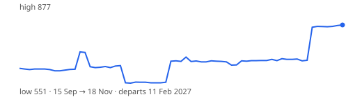
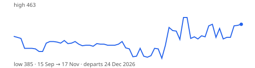

# Flight price tracker: buy-timing report

Updated 2026-11-17 13:19 UTC. 📈 [Price trends over time](TRENDS.md)

| Trip | Dates | Days out | Price now | Typical range | Advice | Confidence | Chance cheaper later |
|---|---|---:|---:|---|---|---|---:|
| TLV → Amsterdam (AMS) | Thu 24 Dec → Mon 28 Dec 2026 | 37 | 1,066 ILS | 1,150–1,900 | 🟢 BUY | High (79%) | 36% |
| TLV → Amsterdam (AMS) | Thu 11 Feb → Mon 15 Feb 2027 | 86 | 1,057 ILS | 1,000–1,200 | 🟢 BUY | Medium (60%) | 40% |
| TLV → Barcelona (BCN) | Thu 24 Dec → Mon 28 Dec 2026 | 37 | 1,091 ILS | 1,050–1,450 | 🔵 WAIT | High (95%) | 100% |
| TLV → Barcelona (BCN) | Thu 11 Feb → Mon 15 Feb 2027 | 86 | 1,133 ILS | 890–1,100 | 🔵 WAIT | High (95%) | 98% |
| TLV → Brussels (BRU) | Thu 24 Dec → Mon 28 Dec 2026 | 37 | 996 ILS | 1,200–2,000 | 🟢 BUY | High (87%) | 28% |
| TLV → Brussels (BRU) | Thu 11 Feb → Mon 15 Feb 2027 | 86 | 874 ILS | 900–1,100 | 🟢 BUY | High (77%) | 38% |
| TLV → Rome (FCO) | Thu 24 Dec → Mon 28 Dec 2026 | 37 | 450 ILS | 530–1,150 | 🟢 BUY | High (88%) | 27% |
| TLV → Rome (FCO) | Thu 11 Feb → Mon 15 Feb 2027 | 86 | 400 ILS | 365–860 | 🟢 BUY | High (95%) | 0% |

**BUY** = unlikely to get meaningfully cheaper before the deadline. **WAIT** = good odds of a lower price; keep watching. **WATCH** = roughly a coin flip; buy if it hits the target price.

## TLV → Amsterdam: 24 Dec – 28 Dec 2026 · 🟢 BUY

Trip: watch +5w · Cheapest airline now: TAROM · Data points: 64 · Likely lowest before deadline: ~1,039 ILS

- 36% chance of a fare at least 5% cheaper before 2026-12-10.
- Price is at or below Google's typical low (1,150).
- Lower than 72% of the 64 daily prices seen for this trip in the last 90 days.
- Today's price is below this trip's recent level by 4%, a dip worth taking.
- Departure falls in a peak period (Christmas / New Year in Europe); these fares usually rise steadily.

## TLV → Amsterdam: 11 Feb – 15 Feb 2027 · 🟢 BUY

Trip: watch +12w · Cheapest airline now: TAROM · Data points: 64 · Likely lowest before deadline: ~1,022 ILS

- 40% chance of a fare at least 5% cheaper before 2027-01-28.
- Lower than 2% of the 64 daily prices seen for this trip in the last 90 days.
- Trend over the last 3 weeks: +8.3% per week.

## TLV → Barcelona: 24 Dec – 28 Dec 2026 · 🔵 WAIT

Trip: watch +5w · Cheapest airline now: Air Europa · Data points: 64 · Target price: 1,036 ILS · Likely lowest before deadline: ~933 ILS

- 100% chance of a fare at least 5% cheaper before 2026-12-10.
- Price is in the cheapest quarter of Google's typical range (1,050-1,450).
- Lower than 41% of the 64 daily prices seen for this trip in the last 90 days.
- Today's price is above this trip's recent level by 12%, likely a temporary spike.
- Departure falls in a peak period (Christmas / New Year in Europe); these fares usually rise steadily.
- Trend over the last 3 weeks: -2.8% per week.
- Expected cheapest around 2026-11-18; buy right away if it drops to 1,036 or less.

## TLV → Barcelona: 11 Feb – 15 Feb 2027 · 🔵 WAIT

Trip: watch +12w · Cheapest airline now: LOT · Data points: 64 · Target price: 1,076 ILS · Likely lowest before deadline: ~1,028 ILS

- 98% chance of a fare at least 5% cheaper before 2027-01-28.
- Price is above Google's typical range (890-1,100).
- Lower than 2% of the 64 daily prices seen for this trip in the last 90 days.
- Today's price is above this trip's recent level by 6%, likely a temporary spike.
- Expected cheapest around 2026-11-18; buy right away if it drops to 1,076 or less.

## TLV → Brussels: 24 Dec – 28 Dec 2026 · 🟢 BUY

Trip: watch +5w · Cheapest airline now: TAROM · Data points: 64 · Likely lowest before deadline: ~995 ILS

- 28% chance of a fare at least 5% cheaper before 2026-12-10.
- Price is at or below Google's typical low (1,200).
- Lower than 67% of the 64 daily prices seen for this trip in the last 90 days.
- Today's price is below this trip's recent level by 10%, a dip worth taking.
- Departure falls in a peak period (Christmas / New Year in Europe); these fares usually rise steadily.

## TLV → Brussels: 11 Feb – 15 Feb 2027 · 🟢 BUY

Trip: watch +12w · Cheapest airline now: SKY express · Data points: 64 · Likely lowest before deadline: ~846 ILS

- 38% chance of a fare at least 5% cheaper before 2027-01-28.
- Price is at or below Google's typical low (900).
- Lower than 2% of the 64 daily prices seen for this trip in the last 90 days.
- Trend over the last 3 weeks: +10.7% per week.

## TLV → Rome: 24 Dec – 28 Dec 2026 · 🟢 BUY

Trip: watch +5w · Cheapest airline now: Wizz Air · Data points: 64 · Likely lowest before deadline: ~435 ILS

- 27% chance of a fare at least 5% cheaper before 2026-12-10.
- Price is at or below Google's typical low (530).
- Lower than 6% of the 64 daily prices seen for this trip in the last 90 days.
- Departure falls in a peak period (Christmas / New Year in Europe); these fares usually rise steadily.

## TLV → Rome: 11 Feb – 15 Feb 2027 · 🟢 BUY

Trip: watch +12w · Cheapest airline now: Wizz Air · Data points: 64 · Likely lowest before deadline: ~393 ILS

- 0% chance of a fare at least 5% cheaper before 2027-01-28.
- Price is in the cheapest quarter of Google's typical range (365-860).
- Lower than 2% of the 64 daily prices seen for this trip in the last 90 days.

_SerpApi searches used this month: 24/248._