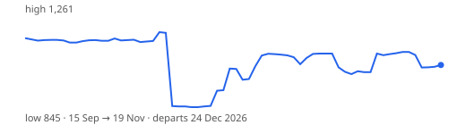
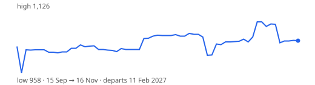

# Flight price tracker: buy-timing report

Updated 2026-11-24 14:50 UTC. 📈 [Price trends over time](TRENDS.md)

| Trip | Dates | Days out | Price now | Typical range | Advice | Confidence | Chance cheaper later |
|---|---|---:|---:|---|---|---|---:|
| TLV → Amsterdam (AMS) | Thu 24 Dec → Mon 28 Dec 2026 | 30 | 1,079 ILS | 1,200–1,900 | 🟢 BUY | Medium (63%) | 52% |
| TLV → Amsterdam (AMS) | Thu 31 Dec → Mon 04 Jan 2027 | 37 | 1,451 ILS | 1,200–1,800 | 🟢 BUY | Medium (70%) | 30% |
| TLV → Amsterdam (AMS) | Thu 11 Feb → Mon 15 Feb 2027 | 79 | 1,074 ILS | 1,000–1,200 | 🟢 BUY | Medium (68%) | 32% |
| TLV → Amsterdam (AMS) | Thu 18 Feb → Mon 22 Feb 2027 | 86 | 1,090 ILS | 1,050–1,200 | 🟢 BUY | Medium (72%) | 28% |
| TLV → Barcelona (BCN) | Thu 24 Dec → Mon 28 Dec 2026 | 30 | 1,104 ILS | 1,100–1,500 | 🟢 BUY | Medium (71%) | 29% |
| TLV → Barcelona (BCN) | Thu 31 Dec → Mon 04 Jan 2027 | 37 | 1,157 ILS | 1,100–1,500 | 🟢 BUY | High (89%) | 11% |
| TLV → Barcelona (BCN) | Thu 11 Feb → Mon 15 Feb 2027 | 79 | 1,083 ILS | 900–1,100 | 🟡 WATCH | Low (53%) | 47% |
| TLV → Barcelona (BCN) | Thu 18 Feb → Mon 22 Feb 2027 | 86 | 1,098 ILS | 910–1,150 | 🔵 WAIT | High (89%) | 89% |
| TLV → Brussels (BRU) | Thu 24 Dec → Mon 28 Dec 2026 | 30 | 1,101 ILS | 1,200–2,000 | 🔵 WAIT | High (78%) | 93% |
| TLV → Brussels (BRU) | Thu 31 Dec → Mon 04 Jan 2027 | 37 | 1,265 ILS | – | 🔵 WAIT | Medium (63%) | 66% |
| TLV → Brussels (BRU) | Thu 11 Feb → Mon 15 Feb 2027 | 79 | 883 ILS | 910–1,100 | 🟢 BUY | High (87%) | 28% |
| TLV → Brussels (BRU) | Thu 18 Feb → Mon 22 Feb 2027 | 86 | 891 ILS | 920–1,100 | 🟢 BUY | High (95%) | 20% |
| TLV → Rome (FCO) | Thu 24 Dec → Mon 28 Dec 2026 | 30 | 440 ILS | 530–1,200 | 🟢 BUY | High (95%) | 6% |
| TLV → Rome (FCO) | Thu 31 Dec → Mon 04 Jan 2027 | 37 | 462 ILS | 540–1,200 | 🔵 WAIT | Medium (72%) | 87% |
| TLV → Rome (FCO) | Thu 11 Feb → Mon 15 Feb 2027 | 79 | 405 ILS | 370–870 | 🟢 BUY | High (95%) | 0% |
| TLV → Rome (FCO) | Thu 18 Feb → Mon 22 Feb 2027 | 86 | 411 ILS | 375–890 | 🟡 WATCH | Low (52%) | 48% |

**BUY** = unlikely to get meaningfully cheaper before the deadline. **WAIT** = good odds of a lower price; keep watching. **WATCH** = roughly a coin flip; buy if it hits the target price.

## TLV → Amsterdam: 24 Dec – 28 Dec 2026 · 🟢 BUY

Trip: watch +5w · Cheapest airline now: TAROM · Data points: 66 · Likely lowest before deadline: ~1,022 ILS

- 52% chance of a fare at least 5% cheaper before 2026-12-10.
- Price is at or below Google's typical low (1,200).
- Lower than 65% of the 66 daily prices seen for this trip in the last 90 days.
- Departure falls in a peak period (Christmas / New Year in Europe); these fares usually rise steadily.
- Trend over the last 3 weeks: +2.2% per week.

## TLV → Amsterdam: 31 Dec – 04 Jan 2027 · 🟢 BUY

Trip: watch +5w · Cheapest airline now: KLM · Data points: 67 · Likely lowest before deadline: ~1,402 ILS

- 30% chance of a fare at least 5% cheaper before 2026-12-17.
- Lower than 6% of the 67 daily prices seen for this trip in the last 90 days.
- Departure falls in a peak period (Christmas / New Year in Europe); these fares usually rise steadily.

## TLV → Amsterdam: 11 Feb – 15 Feb 2027 · 🟢 BUY

Trip: watch +12w · Cheapest airline now: TAROM · Data points: 66 · Likely lowest before deadline: ~1,048 ILS

- 32% chance of a fare at least 5% cheaper before 2027-01-28.
- Lower than 2% of the 66 daily prices seen for this trip in the last 90 days.
- Trend over the last 3 weeks: +12.8% per week.

## TLV → Amsterdam: 18 Feb – 22 Feb 2027 · 🟢 BUY

Trip: watch +12w · Cheapest airline now: TAROM · Data points: 67 · Likely lowest before deadline: ~1,073 ILS

- 28% chance of a fare at least 5% cheaper before 2027-02-04.
- Lower than 3% of the 67 daily prices seen for this trip in the last 90 days.
- Trend over the last 3 weeks: +10.5% per week.

## TLV → Barcelona: 24 Dec – 28 Dec 2026 · 🟢 BUY

Trip: watch +5w · Cheapest airline now: Air Europa · Data points: 66 · Likely lowest before deadline: ~1,069 ILS

- 29% chance of a fare at least 5% cheaper before 2026-12-10.
- Price is in the cheapest quarter of Google's typical range (1,100-1,500).
- Lower than 38% of the 66 daily prices seen for this trip in the last 90 days.
- Departure falls in a peak period (Christmas / New Year in Europe); these fares usually rise steadily.

## TLV → Barcelona: 31 Dec – 04 Jan 2027 · 🟢 BUY

Trip: watch +5w · Cheapest airline now: Air Europa · Data points: 67 · Likely lowest before deadline: ~1,157 ILS

- 11% chance of a fare at least 5% cheaper before 2026-12-17.
- Price is in the cheapest quarter of Google's typical range (1,100-1,500).
- Lower than 12% of the 67 daily prices seen for this trip in the last 90 days.
- Departure falls in a peak period (Christmas / New Year in Europe); these fares usually rise steadily.
- Trend over the last 3 weeks: +5.4% per week.

## TLV → Barcelona: 11 Feb – 15 Feb 2027 · 🟡 WATCH

Trip: watch +12w · Cheapest airline now: LOT · Data points: 66 · Target price: 1,029 ILS · Likely lowest before deadline: ~1,032 ILS

- 47% chance of a fare at least 5% cheaper before 2027-01-28.
- Lower than 20% of the 66 daily prices seen for this trip in the last 90 days.
- Expected cheapest around 2026-12-27; buy right away if it drops to 1,029 or less.

## TLV → Barcelona: 18 Feb – 22 Feb 2027 · 🔵 WAIT

Trip: watch +12w · Cheapest airline now: LOT · Data points: 63 · Target price: 1,043 ILS · Likely lowest before deadline: ~922 ILS

- 89% chance of a fare at least 5% cheaper before 2027-02-04.
- Lower than 21% of the 63 daily prices seen for this trip in the last 90 days.
- Expected cheapest around 2027-01-02; buy right away if it drops to 1,043 or less.

## TLV → Brussels: 24 Dec – 28 Dec 2026 · 🔵 WAIT

Trip: watch +5w · Cheapest airline now: TAROM · Data points: 66 · Target price: 1,046 ILS · Likely lowest before deadline: ~957 ILS

- 93% chance of a fare at least 5% cheaper before 2026-12-10.
- Price is at or below Google's typical low (1,200).
- Lower than 8% of the 66 daily prices seen for this trip in the last 90 days.
- Today's price is above this trip's recent level by 5%, likely a temporary spike.
- Departure falls in a peak period (Christmas / New Year in Europe); these fares usually rise steadily.
- Expected cheapest around 2026-11-25; buy right away if it drops to 1,046 or less.

## TLV → Brussels: 31 Dec – 04 Jan 2027 · 🔵 WAIT

Trip: watch +5w · Cheapest airline now: Brussels Airlines, Lufthansa · Data points: 67 · Target price: 1,202 ILS · Likely lowest before deadline: ~1,172 ILS

- 66% chance of a fare at least 5% cheaper before 2026-12-17.
- Lower than 27% of the 67 daily prices seen for this trip in the last 90 days.
- Departure falls in a peak period (Christmas / New Year in Europe); these fares usually rise steadily.
- Trend over the last 3 weeks: +2.0% per week.
- Expected cheapest around 2026-11-25; buy right away if it drops to 1,202 or less.

## TLV → Brussels: 11 Feb – 15 Feb 2027 · 🟢 BUY

Trip: watch +12w · Cheapest airline now: SKY express · Data points: 66 · Likely lowest before deadline: ~866 ILS

- 28% chance of a fare at least 5% cheaper before 2027-01-28.
- Price is at or below Google's typical low (910).
- Lower than 2% of the 66 daily prices seen for this trip in the last 90 days.
- Trend over the last 3 weeks: +16.6% per week.

## TLV → Brussels: 18 Feb – 22 Feb 2027 · 🟢 BUY

Trip: watch +12w · Cheapest airline now: TAROM · Data points: 67 · Likely lowest before deadline: ~886 ILS

- 20% chance of a fare at least 5% cheaper before 2027-02-04.
- Price is at or below Google's typical low (920).
- Lower than 6% of the 67 daily prices seen for this trip in the last 90 days.
- Trend over the last 3 weeks: +13.3% per week.

## TLV → Rome: 24 Dec – 28 Dec 2026 · 🟢 BUY

Trip: watch +5w · Cheapest airline now: Wizz Air · Data points: 66 · Likely lowest before deadline: ~435 ILS

- 6% chance of a fare at least 5% cheaper before 2026-12-10.
- Price is at or below Google's typical low (530).
- Lower than 15% of the 66 daily prices seen for this trip in the last 90 days.
- Departure falls in a peak period (Christmas / New Year in Europe); these fares usually rise steadily.

## TLV → Rome: 31 Dec – 04 Jan 2027 · 🔵 WAIT

Trip: watch +5w · Cheapest airline now: Wizz Air · Data points: 67 · Target price: 439 ILS · Likely lowest before deadline: ~425 ILS

- 87% chance of a fare at least 5% cheaper before 2026-12-17.
- Price is at or below Google's typical low (540).
- Lower than 1% of the 67 daily prices seen for this trip in the last 90 days.
- Today's price is above this trip's recent level by 6%, likely a temporary spike.
- Departure falls in a peak period (Christmas / New Year in Europe); these fares usually rise steadily.
- Trend over the last 3 weeks: +2.1% per week.
- Expected cheapest around 2026-11-25; buy right away if it drops to 439 or less.

## TLV → Rome: 11 Feb – 15 Feb 2027 · 🟢 BUY

Trip: watch +12w · Cheapest airline now: Wizz Air · Data points: 66 · Likely lowest before deadline: ~398 ILS

- 0% chance of a fare at least 5% cheaper before 2027-01-28.
- Price is in the cheapest quarter of Google's typical range (370-870).
- Lower than 2% of the 66 daily prices seen for this trip in the last 90 days.

## TLV → Rome: 18 Feb – 22 Feb 2027 · 🟡 WATCH

Trip: watch +12w · Cheapest airline now: Wizz Air · Data points: 67 · Target price: 390 ILS · Likely lowest before deadline: ~391 ILS

- 48% chance of a fare at least 5% cheaper before 2027-02-04.
- Price is in the cheapest quarter of Google's typical range (375-890).
- Lower than 42% of the 67 daily prices seen for this trip in the last 90 days.
- Expected cheapest around 2026-11-25; buy right away if it drops to 390 or less.

_SerpApi searches used this month: 80/248._