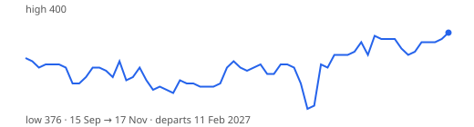
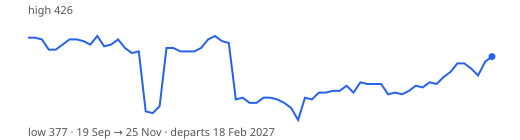

# Flight price tracker: buy-timing report

Updated 2026-11-26 13:51 UTC. 📈 [Price trends over time](TRENDS.md)

| Trip | Dates | Days out | Price now | Typical range | Advice | Confidence | Chance cheaper later |
|---|---|---:|---:|---|---|---|---:|
| TLV → Amsterdam (AMS) | Thu 24 Dec → Mon 28 Dec 2026 | 28 | 1,079 ILS | 1,200–1,900 | 🟡 WATCH | Low (59%) | 56% |
| TLV → Amsterdam (AMS) | Thu 31 Dec → Mon 04 Jan 2027 | 35 | 1,258 ILS | 1,200–1,800 | 🟢 BUY | High (85%) | 15% |
| TLV → Amsterdam (AMS) | Thu 11 Feb → Mon 15 Feb 2027 | 77 | 1,074 ILS | 1,000–1,200 | 🟢 BUY | Medium (65%) | 35% |
| TLV → Amsterdam (AMS) | Thu 18 Feb → Mon 22 Feb 2027 | 84 | 1,017 ILS | 1,050–1,200 | 🟢 BUY | High (91%) | 24% |
| TLV → Barcelona (BCN) | Thu 24 Dec → Mon 28 Dec 2026 | 28 | 1,104 ILS | 1,100–1,500 | 🟢 BUY | Medium (66%) | 34% |
| TLV → Barcelona (BCN) | Thu 31 Dec → Mon 04 Jan 2027 | 35 | 989 ILS | 1,100–1,500 | 🟢 BUY | High (77%) | 38% |
| TLV → Barcelona (BCN) | Thu 11 Feb → Mon 15 Feb 2027 | 77 | 1,083 ILS | 900–1,100 | 🔵 WAIT | High (78%) | 78% |
| TLV → Barcelona (BCN) | Thu 18 Feb → Mon 22 Feb 2027 | 84 | 877 ILS | 910–1,150 | 🔵 WAIT | Medium (70%) | 85% |
| TLV → Brussels (BRU) | Thu 24 Dec → Mon 28 Dec 2026 | 28 | 1,101 ILS | 1,200–2,000 | 🔵 WAIT | High (77%) | 92% |
| TLV → Brussels (BRU) | Thu 31 Dec → Mon 04 Jan 2027 | 35 | 1,259 ILS | 1,200–1,900 | 🟡 WATCH | Low (58%) | 58% |
| TLV → Brussels (BRU) | Thu 11 Feb → Mon 15 Feb 2027 | 77 | 883 ILS | 910–1,100 | 🟢 BUY | High (85%) | 30% |
| TLV → Brussels (BRU) | Thu 18 Feb → Mon 22 Feb 2027 | 84 | 859 ILS | 920–1,100 | 🟢 BUY | High (94%) | 21% |
| TLV → Rome (FCO) | Thu 24 Dec → Mon 28 Dec 2026 | 28 | 440 ILS | 530–1,200 | 🟢 BUY | High (95%) | 5% |
| TLV → Rome (FCO) | Thu 31 Dec → Mon 04 Jan 2027 | 35 | 461 ILS | 530–1,150 | 🟢 BUY | High (95%) | 19% |
| TLV → Rome (FCO) | Thu 11 Feb → Mon 15 Feb 2027 | 77 | 405 ILS | 370–870 | 🟢 BUY | High (95%) | 0% |
| TLV → Rome (FCO) | Thu 18 Feb → Mon 22 Feb 2027 | 84 | 424 ILS | 375–880 | 🔵 WAIT | Medium (70%) | 70% |

**BUY** = unlikely to get meaningfully cheaper before the deadline. **WAIT** = good odds of a lower price; keep watching. **WATCH** = roughly a coin flip; buy if it hits the target price.

## TLV → Amsterdam: 24 Dec – 28 Dec 2026 · 🟡 WATCH

Trip: watch +5w · Cheapest airline now: TAROM · Data points: 66 · Target price: 1,025 ILS · Likely lowest before deadline: ~1,017 ILS

- 56% chance of a fare at least 5% cheaper before 2026-12-10.
- Price is at or below Google's typical low (1,200).
- Lower than 65% of the 66 daily prices seen for this trip in the last 90 days.
- Departure falls in a peak period (Christmas / New Year in Europe); these fares usually rise steadily.
- Expected cheapest around 2026-11-27; buy right away if it drops to 1,025 or less.

## TLV → Amsterdam: 31 Dec – 04 Jan 2027 · 🟢 BUY

Trip: watch +5w · Cheapest airline now: KLM · Data points: 69 · Likely lowest before deadline: ~1,256 ILS

- 15% chance of a fare at least 5% cheaper before 2026-12-17.
- Price is in the cheapest quarter of Google's typical range (1,200-1,800).
- Lower than 45% of the 69 daily prices seen for this trip in the last 90 days.
- Today's price is below this trip's recent level by 7%, a dip worth taking.
- Departure falls in a peak period (Christmas / New Year in Europe); these fares usually rise steadily.

## TLV → Amsterdam: 11 Feb – 15 Feb 2027 · 🟢 BUY

Trip: watch +12w · Cheapest airline now: TAROM · Data points: 66 · Likely lowest before deadline: ~1,044 ILS

- 35% chance of a fare at least 5% cheaper before 2027-01-28.
- Lower than 2% of the 66 daily prices seen for this trip in the last 90 days.
- Trend over the last 3 weeks: +14.7% per week.

## TLV → Amsterdam: 18 Feb – 22 Feb 2027 · 🟢 BUY

Trip: watch +12w · Cheapest airline now: SKY express · Data points: 69 · Likely lowest before deadline: ~1,017 ILS

- 24% chance of a fare at least 5% cheaper before 2027-02-04.
- Price is at or below Google's typical low (1,050).
- Lower than 22% of the 69 daily prices seen for this trip in the last 90 days.
- Trend over the last 3 weeks: +8.6% per week.

## TLV → Barcelona: 24 Dec – 28 Dec 2026 · 🟢 BUY

Trip: watch +5w · Cheapest airline now: Air Europa · Data points: 66 · Likely lowest before deadline: ~1,065 ILS

- 34% chance of a fare at least 5% cheaper before 2026-12-10.
- Price is in the cheapest quarter of Google's typical range (1,100-1,500).
- Lower than 38% of the 66 daily prices seen for this trip in the last 90 days.
- Departure falls in a peak period (Christmas / New Year in Europe); these fares usually rise steadily.

## TLV → Barcelona: 31 Dec – 04 Jan 2027 · 🟢 BUY

Trip: watch +5w · Cheapest airline now: Air Europa · Data points: 69 · Likely lowest before deadline: ~956 ILS

- 38% chance of a fare at least 5% cheaper before 2026-12-17.
- Price is at or below Google's typical low (1,100).
- Lower than 88% of the 69 daily prices seen for this trip in the last 90 days.
- Departure falls in a peak period (Christmas / New Year in Europe); these fares usually rise steadily.
- Trend over the last 3 weeks: +2.3% per week.

## TLV → Barcelona: 11 Feb – 15 Feb 2027 · 🔵 WAIT

Trip: watch +12w · Cheapest airline now: LOT · Data points: 66 · Target price: 1,029 ILS · Likely lowest before deadline: ~999 ILS

- 78% chance of a fare at least 5% cheaper before 2027-01-28.
- Lower than 20% of the 66 daily prices seen for this trip in the last 90 days.
- Expected cheapest around 2026-12-23; buy right away if it drops to 1,029 or less.

## TLV → Barcelona: 18 Feb – 22 Feb 2027 · 🔵 WAIT

Trip: watch +12w · Cheapest airline now: Air Europa · Data points: 65 · Target price: 833 ILS · Likely lowest before deadline: ~731 ILS

- 85% chance of a fare at least 5% cheaper before 2027-02-04.
- Price is at or below Google's typical low (910).
- Lower than 91% of the 65 daily prices seen for this trip in the last 90 days.
- Trend over the last 3 weeks: -4.6% per week.
- Expected cheapest around 2026-12-24; buy right away if it drops to 833 or less.

## TLV → Brussels: 24 Dec – 28 Dec 2026 · 🔵 WAIT

Trip: watch +5w · Cheapest airline now: TAROM · Data points: 66 · Target price: 1,046 ILS · Likely lowest before deadline: ~962 ILS

- 92% chance of a fare at least 5% cheaper before 2026-12-10.
- Price is at or below Google's typical low (1,200).
- Lower than 8% of the 66 daily prices seen for this trip in the last 90 days.
- Today's price is above this trip's recent level by 5%, likely a temporary spike.
- Departure falls in a peak period (Christmas / New Year in Europe); these fares usually rise steadily.
- Expected cheapest around 2026-11-27; buy right away if it drops to 1,046 or less.

## TLV → Brussels: 31 Dec – 04 Jan 2027 · 🟡 WATCH

Trip: watch +5w · Cheapest airline now: Brussels Airlines, Lufthansa · Data points: 69 · Target price: 1,196 ILS · Likely lowest before deadline: ~1,180 ILS

- 58% chance of a fare at least 5% cheaper before 2026-12-17.
- Price is in the cheapest quarter of Google's typical range (1,200-1,900).
- Lower than 32% of the 69 daily prices seen for this trip in the last 90 days.
- Departure falls in a peak period (Christmas / New Year in Europe); these fares usually rise steadily.

## TLV → Brussels: 11 Feb – 15 Feb 2027 · 🟢 BUY

Trip: watch +12w · Cheapest airline now: SKY express · Data points: 66 · Likely lowest before deadline: ~865 ILS

- 30% chance of a fare at least 5% cheaper before 2027-01-28.
- Price is at or below Google's typical low (910).
- Lower than 2% of the 66 daily prices seen for this trip in the last 90 days.
- Trend over the last 3 weeks: +19.0% per week.

## TLV → Brussels: 18 Feb – 22 Feb 2027 · 🟢 BUY

Trip: watch +12w · Cheapest airline now: SKY express · Data points: 69 · Likely lowest before deadline: ~857 ILS

- 21% chance of a fare at least 5% cheaper before 2027-02-04.
- Price is at or below Google's typical low (920).
- Lower than 22% of the 69 daily prices seen for this trip in the last 90 days.
- Trend over the last 3 weeks: +11.2% per week.

## TLV → Rome: 24 Dec – 28 Dec 2026 · 🟢 BUY

Trip: watch +5w · Cheapest airline now: Wizz Air · Data points: 66 · Likely lowest before deadline: ~435 ILS

- 5% chance of a fare at least 5% cheaper before 2026-12-10.
- Price is at or below Google's typical low (530).
- Lower than 15% of the 66 daily prices seen for this trip in the last 90 days.
- Departure falls in a peak period (Christmas / New Year in Europe); these fares usually rise steadily.

## TLV → Rome: 31 Dec – 04 Jan 2027 · 🟢 BUY

Trip: watch +5w · Cheapest airline now: Wizz Air · Data points: 69 · Likely lowest before deadline: ~451 ILS

- 19% chance of a fare at least 5% cheaper before 2026-12-17.
- Price is at or below Google's typical low (530).
- Lower than 4% of the 69 daily prices seen for this trip in the last 90 days.
- Departure falls in a peak period (Christmas / New Year in Europe); these fares usually rise steadily.
- Trend over the last 3 weeks: +3.5% per week.

## TLV → Rome: 11 Feb – 15 Feb 2027 · 🟢 BUY

Trip: watch +12w · Cheapest airline now: Wizz Air · Data points: 66 · Likely lowest before deadline: ~398 ILS

- 0% chance of a fare at least 5% cheaper before 2027-01-28.
- Price is in the cheapest quarter of Google's typical range (370-870).
- Lower than 2% of the 66 daily prices seen for this trip in the last 90 days.

## TLV → Rome: 18 Feb – 22 Feb 2027 · 🔵 WAIT

Trip: watch +12w · Cheapest airline now: Wizz Air · Data points: 69 · Target price: 403 ILS · Likely lowest before deadline: ~397 ILS

- 70% chance of a fare at least 5% cheaper before 2027-02-04.
- Price is in the cheapest quarter of Google's typical range (375-880).
- Lower than 14% of the 69 daily prices seen for this trip in the last 90 days.
- Expected cheapest around 2026-11-27; buy right away if it drops to 403 or less.

_SerpApi searches used this month: 96/248._