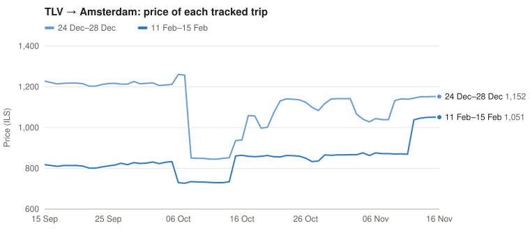
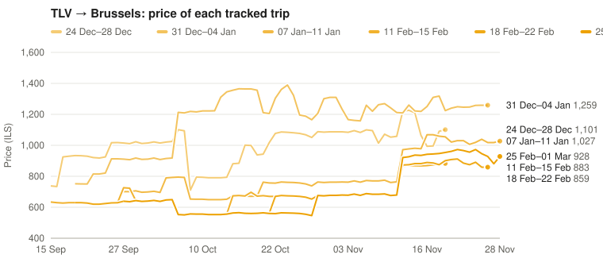
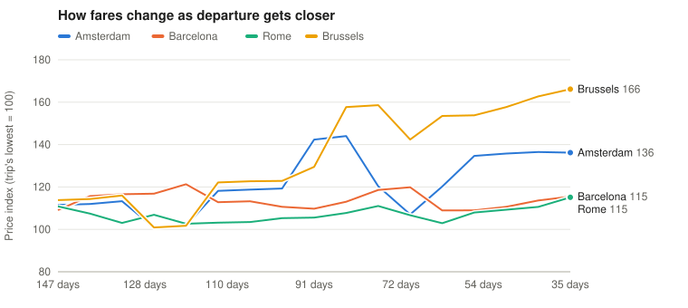

# Price trends

Built from every price the tracker has saved (`data/observations.csv`) plus Google's own daily history for each tracked trip (`data/source_history.csv`). Prices are round trip, in ILS. The charts grow every day the job runs.

## All cities

Each day, the lowest price among the trips being tracked for that city. Jumps can happen when the tracker switches to a new watch date.

## Each trip over time

One line per departure date. A line that climbs means that trip got more expensive the longer you waited.

### Amsterdam

### Barcelona

### Rome

### Brussels

## Price vs. time before departure

Every trip's price divided by its own lowest price (= 100), grouped by weeks before departure. Read left to right: further out on the left, departure on the right. Where the line turns up is when waiting starts to cost you. This is the curve the buy-timing algorithm learns from.

## Latest checks

| City | Departure | Return | Price | Checked |
|---|---|---|---:|---|
| Amsterdam | 2026-12-24 | 2026-12-28 | 1,069 ILS | 2026-11-18 |
| Amsterdam | 2027-02-11 | 2027-02-15 | 1,063 ILS | 2026-11-18 |
| Barcelona | 2026-12-24 | 2026-12-28 | 1,096 ILS | 2026-11-18 |
| Barcelona | 2027-02-11 | 2027-02-15 | 1,139 ILS | 2026-11-18 |
| Brussels | 2026-12-24 | 2026-12-28 | 1,091 ILS | 2026-11-18 |
| Brussels | 2027-02-11 | 2027-02-15 | 877 ILS | 2026-11-18 |
| Rome | 2026-12-24 | 2026-12-28 | 437 ILS | 2026-11-18 |
| Rome | 2027-02-11 | 2027-02-15 | 401 ILS | 2026-11-18 |
